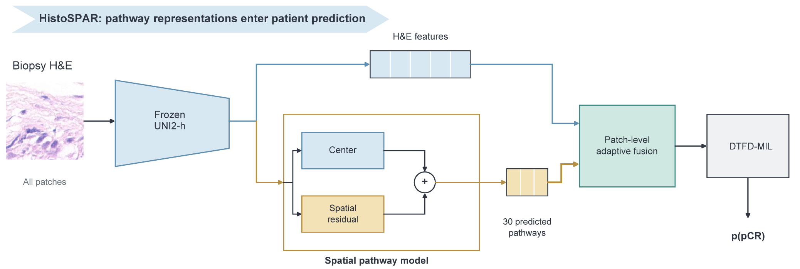
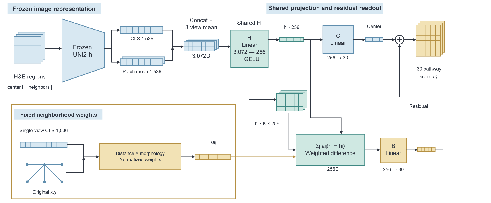
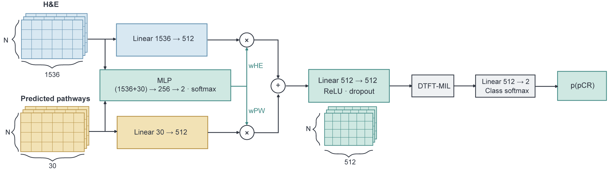

# HistoSPAR

The source code for the research article:  
**"Spatial pathway reconstruction from H&E histology enhances prediction of pathological complete response to neoadjuvant chemoimmunotherapy in esophageal squamous cell carcinoma."**

---

<p align="center">
  
</p>

HistoSPAR connects spatially supervised pathway activity reconstruction from standard hematoxylin and eosin (H&E) histology with adaptive multimodal fusion and Multiple Instance Learning (MIL) to predict pathological complete response (pCR) to neoadjuvant chemoimmunotherapy in esophageal squamous cell carcinoma (ESCC).

---

## System Requirements

This codebase was developed and tested in the following environment:

### Operating System
- Linux (Ubuntu 20.04 / 22.04 LTS)

### GPU
- NVIDIA GeForce RTX 4080

### Dependencies
- Python (3.11)
- PyTorch (2.5.1)
- torchvision (>= 0.20.1)
- CUDA (12.1)
- Scanpy (1.10.3)
- GSEApy (1.1.11)
- Space Ranger (v4.0.1)

---

## Installation Guide

Create and activate the conda environment:

```bash
conda env create -f environment.yml
conda activate aipatho
```

---

## Preprocessing

<p align="center">
  
</p>

### Slide & Data Directory Structure
```text
DATA_ROOT/
├── visium_hd/
│   ├── raw_counts.h5ad            # 2-µm Visium HD expression matrix
│   └── spatial_positions.csv      # Spot coordinates and registered metadata
└── wsi_slides/
    ├── case_id/
    │   ├── slide_id.svs           # Whole slide H&E image
    │   └── ...
    └── ...
```

### 1. Generating Spatial Pathway Targets
Aggregates 2-µm Visium HD bins into regional tissue patches (~60 µm, 224–448 px) and derives 30 rank-weighted continuous ssGSEA pathway targets ($\alpha = 0.25$):
```bash
python -m preprocessing.spatial_targets
```

### 2. Extracting Histology Representations
Encodes regional tissue tiles via frozen [UNI2-h](https://huggingface.co/MahmoodLab/UNI2-h) (ViT-Giant, layer 24). Combines CLS and mean patch-token features across 8 dihedral views ($D_4$ group) to form a 3,072-dimensional joint multiview readout:
```bash
python -m preprocessing.extract_features
```

---

## Model Development & Training

<p align="center">
  
</p>

### Stage 1: Training Spatial Pathway Reconstruction
Trains the dual-readout neural architecture coupling a center morphology readout $C$ with an unbiased zero-initialized spatial residual head $B$ on distance- and morphology-weighted spatial graphs:
```bash
python train_spatial.py --batch_size 32 --lr 1e-4 --max_epochs 120
```

### Stage 2: Training Multimodal Clinical Response Predictor (DTFD-MIL)
Trains the primary champion Double-Tier Feature Distillation MIL (DTFD-MIL) network using adaptive 2-way Softmax fusion and decoupled dual optimizers with gradient detachment:
```bash
python train_clinical.py --arm Fusion --max_epochs 200 --lr 1e-4
```
*(Single-modal comparator arms can be trained via `--arm Image` or `--arm Pathway`)*

### Stage 3: Clinical Evaluation & Threshold Calibration
Executes repeated internal cross-validation and prospective external cohort evaluation with Youden's Index cutoff calibration:
```bash
python evaluate.py --folds 5
```

### Stage 4: Biological Interpretability & Feature Attribution
Computes high-precision Conditional Pathway Integrated Gradients (Conditional IG) along Gauss-Legendre quadrature paths and Grouped Shapley values across 31 players (morphology block + 30 pathway channels) grounded on DTFD-MIL:
```bash
python interpretability.py --channel 0 --steps 64 --permutations 16
```

### Stage 5: Systematic Ablation Studies
Runs the 6-dimension ablation protocols (spatial sampling density, residual mechanisms, direct vs. gene-mediated pathway prediction, spatial alignment, 4-way train/inference permutation matrices, and functional pathway group deletions):
```bash
python run_ablations.py
```

---

## Repository Structure

```text
HistoSPAR/
├── train_spatial.py                    # Stage 1: Spatial Pathway Reconstruction training & inference
├── train_clinical.py                   # Stage 2: Multimodal DTFD-MIL clinical response training
├── evaluate.py                         # Stage 3: Validation, Youden calibration & prospective testing
├── interpretability.py                 # Stage 4: Conditional IG & Grouped Shapley feature attribution
├── run_ablations.py                    # Stage 5: 6-dimension systematic ablation study suite
│
├── models/                             # Core neural network architectures
│   ├── __init__.py                     # Model exports
│   ├── spatial_reconstruction.py       # Dual-readout network (H, C, B) & spatial neighborhood graph builder
│   ├── fusion.py                       # Adaptive 2-way Softmax gating & PatchEncoder
│   └── aggregators/                    # Multiple Instance Learning aggregators
│       ├── __init__.py
│       ├── dtfd_mil.py                 # Champion DTFD-MIL & GatedAttention (Zhang et al., CVPR 2022)
│       ├── ab_mil.py                   # Comparative baseline: Attention-based MIL (Ilse et al., ICML 2018)
│       └── clam_sb.py                  # Comparative baseline: CLAM single-branch (Lu et al., Nat Biomed Eng 2021)
│
├── preprocessing/                      # Data processing & feature extraction pipelines
│   ├── __init__.py
│   ├── spatial_targets.py              # Visium HD bin aggregation & rank-weighted ssGSEA
│   └── extract_features.py             # Frozen UNI2-h joint multiview (3072-d) & single-view CLS (1536-d)
│
├── utils/                              # Shared statistical metrics & threshold calibration
│   ├── __init__.py
│   └── metrics.py                      # Macro/Flat PCC, zMSE, raw MAE, AUROC, AP, Youden calibration, mean/SD
│
├── figure/                             # Architecture diagrams and framework panels
│   ├── overview.png
│   ├── spatial_pathway_model.png
│   ├── clinical_fusion_model.png
│   └── README.md
│
├── environment.yml                     # Conda software environment specification
└── README.md                           # Documentation & execution guide
```

---

## Acknowledgements

We gratefully acknowledge the developers of the following open-source frameworks and models:

- **[UNI2-h](https://huggingface.co/MahmoodLab/UNI2-h)**: Pretrained vision foundation model for computational pathology developed by Mahmood Lab ([Chen et al., *Nature Medicine* 2024](https://doi.org/10.1038/s41591-024-02857-3)).
- **[DTFD-MIL](https://github.com/hrzhang1123/DTFD-MIL)**: Double-Tier Feature Distillation Multiple Instance Learning framework developed by Zhang et al. ([*CVPR* 2022](https://openaccess.thecvf.com/content/CVPR2022/html/Zhang_DTFD-MIL_Double-Tier_Feature_Distillation_Multiple_Instance_Learning_for_Histopathology_Whole_CVPR_2022_paper.html)).
- **[Scanpy](https://github.com/scverse/scanpy)**: Large-scale spatial transcriptomics analysis toolkit in Python ([Wolf et al., *Genome Biology* 2018](https://doi.org/10.1186/s13059-017-1382-0)).
- **[OpenSlide](https://openslide.org/)**: Library for reading whole-slide digital pathology images ([Goode et al., *Journal of Pathology Informatics* 2013](https://doi.org/10.4103/2153-3539.119005)).

---

## Citation

*Coming soon.*
